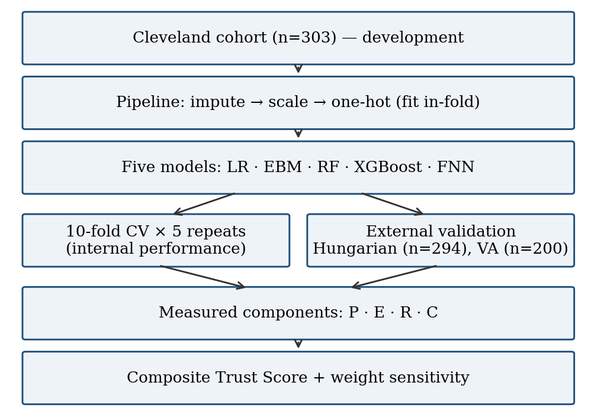
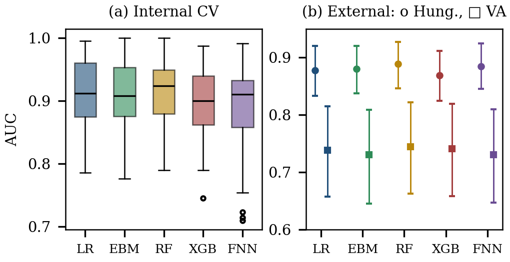
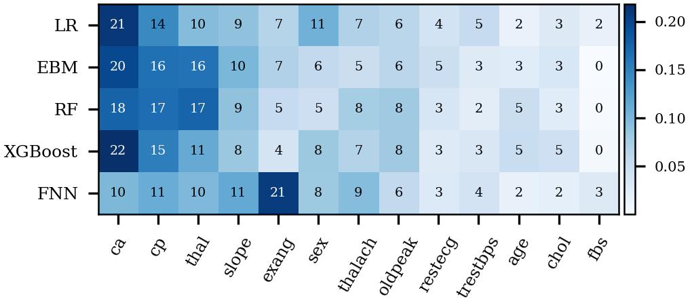
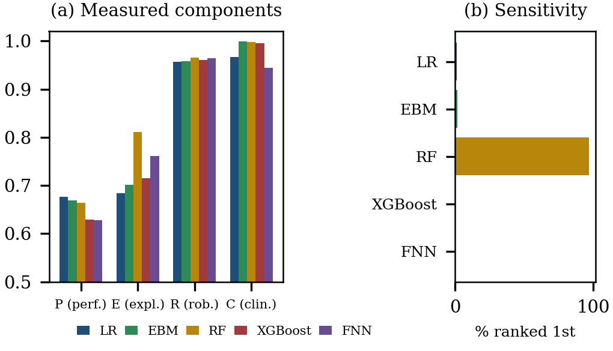

# Quantifying Trustworthiness in Cardiovascular Disease Prediction

**A Measurement-Based Framework with External Validation**

Code and figures for my MSc research (MSc IT with Data Analytics, University of the West of Scotland, London Campus).

> 📄 The paper is currently under review. A link to the published version will be added here once it is available.

---

## Overview

Composite "trust scores" for clinical AI are often built from ratings the authors assign themselves, so they can end up confirming what the authors already believed. This project builds a **Trustworthiness Score in which every component is computed from measurements**, then checks how much the conclusion depends on the weights.

| Component | How it is measured |
|---|---|
| **P** — Performance | Discrimination (AUC) and calibration (Brier score) |
| **E** — Explainability | Bootstrap stability of SHAP attributions + SHAP–LIME local agreement |
| **R** — Robustness | Prediction-flip rate under 10% measurement noise + AUC retained under dataset shift |
| **C** — Clinical alignment | Importance-weighted concordance of SHAP directions with pre-specified clinical priors |

**Models:** Logistic Regression (LR), Explainable Boosting Machine (EBM), Random Forest (RF), XGBoost, Feed-forward Neural Network (FNN)

**Data:** developed on the Cleveland cohort (n = 303) with 10-fold cross-validation × 5 repeats; externally validated on the Hungarian (n = 294) and VA Long Beach (n = 200) cohorts.

## Key findings

- Cross-validated AUC ranged from 0.892 to 0.912. No model differed significantly from LR (corrected resampled t-test, all p ≥ 0.13).
- All models lost discrimination under dataset shift: external AUC was 0.87–0.89 on Hungarian and 0.73–0.74 on VA.
- What separated the models was **explanation stability and SHAP–LIME agreement**, not accuracy.
- **RF obtained the highest Trust Score** and ranked first under 97% of 20,000 random weightings, though total scores spanned only about five points.
- In an earlier expert-rated version of the score, LR ranked first. **Replacing ratings with measurements changed the preferred model.**

---

## Pipeline



## Results

**Internal and external discrimination**



**Normalised SHAP feature importance (%)**



**Trust Score components and weight sensitivity**



---

## Repository structure

```
trustworthy-ai-cvd/
├── trust_cvd_pipeline.py   # Full pipeline (3 stages, see below)
├── requirements.txt
├── figs/                   # Figures used in the paper
│   ├── fig1.png
│   ├── fig2.png
│   ├── fig3.png
│   └── fig4.png
├── LICENSE
└── README.md
```

The script runs in three stages:

1. **Experiments** — repeated CV, noise robustness, external validation with bootstrap CIs, SHAP/LIME explanations → `results.json`
2. **Trust Score** — computes P, E, R, C, three weighting schemes and a 20,000-draw Dirichlet sensitivity analysis → `final.json`
3. **Figures** — writes `figs/fig1.png` to `figs/fig4.png`

## How to run

```bash
# 1. Clone the repository
git clone https://github.com/ashrafhussan/trustworthy-ai-cvd.git
cd trustworthy-ai-cvd

# 2. (Optional) create a virtual environment
python -m venv venv
venv\Scripts\activate        # Windows
# source venv/bin/activate   # macOS / Linux

# 3. Install dependencies
pip install -r requirements.txt

# 4. Download the data into this folder (see below), then run
python trust_cvd_pipeline.py
```

Runtime is about 15 minutes on a laptop.

## Data

From the [UCI Heart Disease dataset](https://archive.ics.uci.edu/dataset/45/heart+disease) (CC BY 4.0). Download these three files into the project folder:

- `processed.cleveland.data`
- `processed.hungarian.data`
- `processed.va.data`

## Limitations

- Small public cohorts collected decades ago; results need confirmation on modern clinical data.
- Total Trust Scores are close together, so the ranking should be read alongside the sensitivity analysis.

---

## Author

**Ashraf Hussan Babor**
Founder & CEO, Dashient Ltd · Builder of [ScopeCheck](https://scopecheck.co.uk), an AI quote-comparison tool for UK homeowners

[GitHub](https://github.com/ashrafhussan) · [LinkedIn](https://linkedin.com/in/ahbabor12) · [Portfolio](https://ashrafbabor.com) · ashrafhussanmailofficial@gmail.com

## Citation

Full citation will be added after publication.

```
A. H. Babor, "Quantifying Trustworthiness in Cardiovascular Disease Prediction:
A Measurement-Based Framework with External Validation," 2026.
```

## License

Code released under the MIT License.
